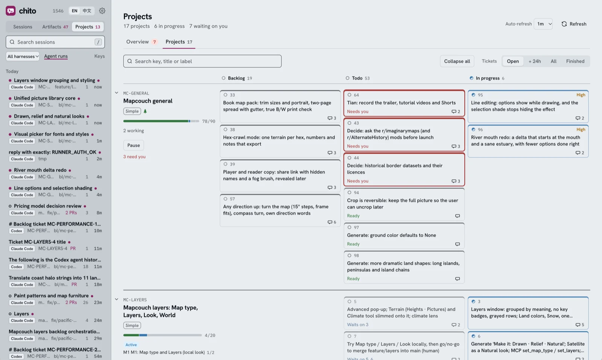
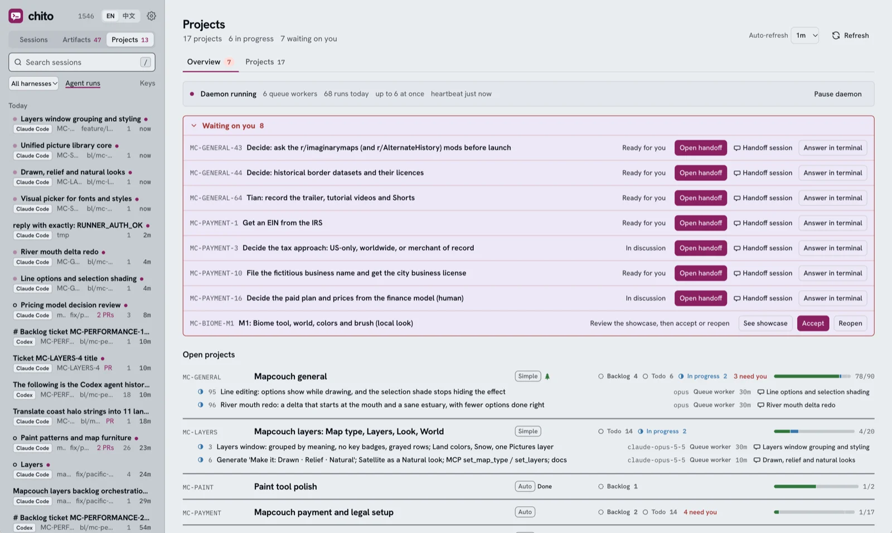
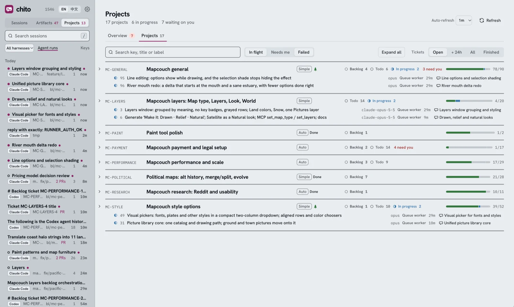
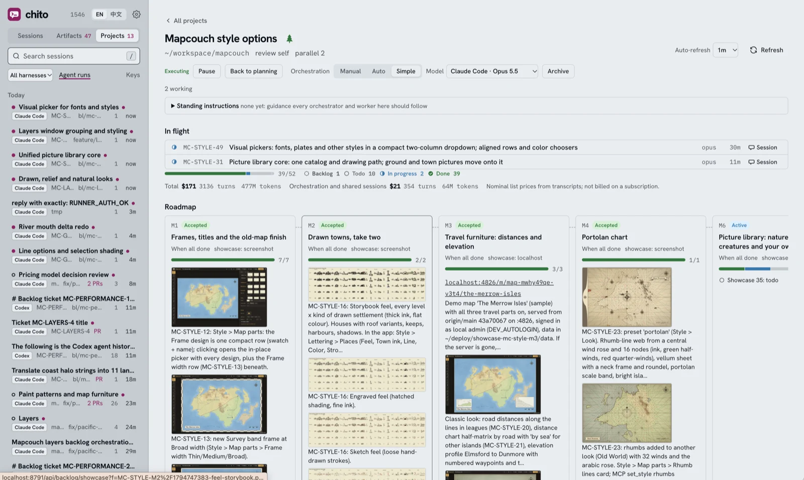
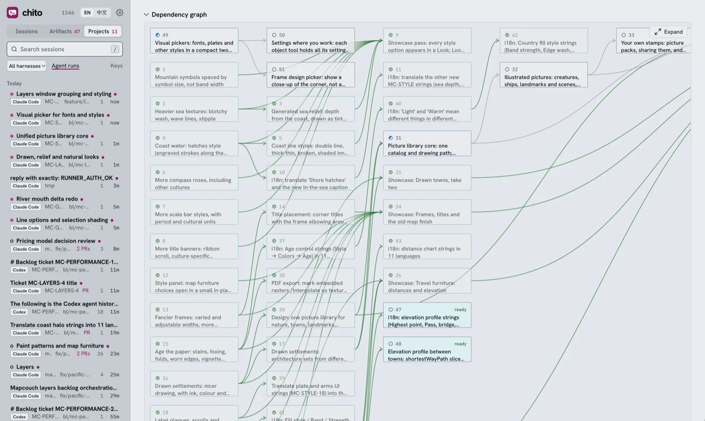
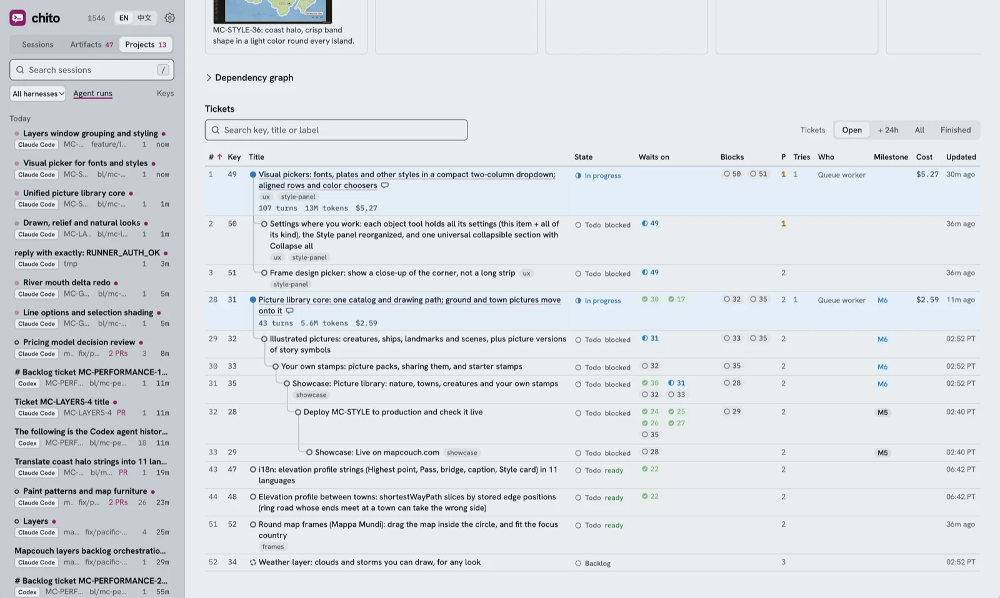
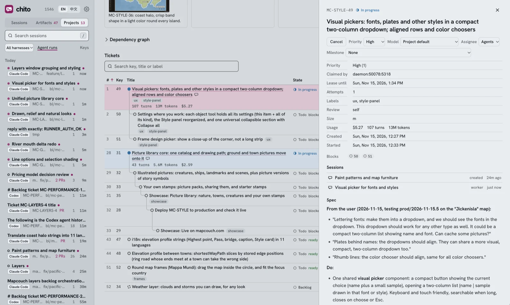
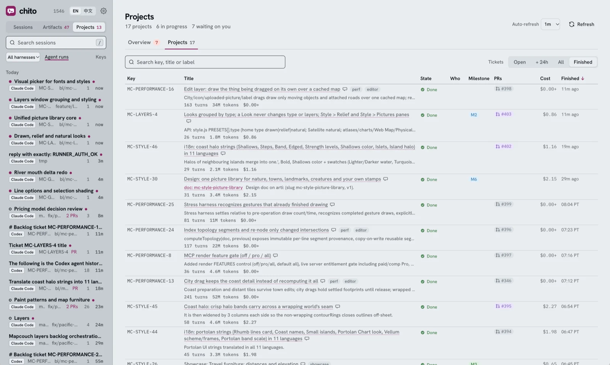
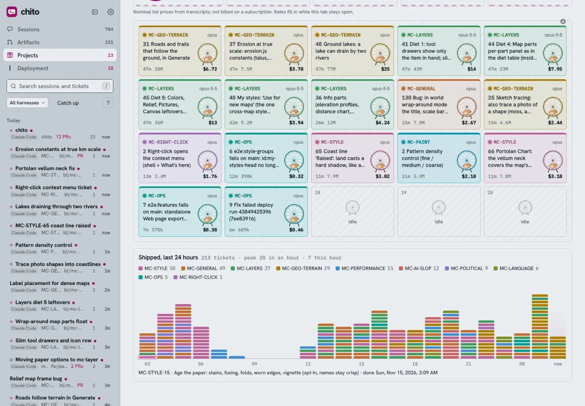

# chito

**A local home for your coding agents.** chito reads every Claude Code, Codex and Pi session on your Mac and shows
them as clean conversations you can search, link to and pick up again. It also ships **backlog**: tickets, a
dependency graph and a background daemon, so a fleet of agents can work through long projects while you look on
from a board, answer what only you can, and accept their demos.

Everything runs on your machine. It reads the transcripts already on disk and serves http://localhost:8791.



## Set it up

The easy way is to ask your coding agent. Paste this into Claude Code, Codex or Pi:

```text
Set up chito on this Mac by following https://github.com/wangtian24/chito/blob/main/SETUP.md
```

[SETUP.md](SETUP.md) is written for agents. It checks the machine (`scripts/doctor.sh`), installs, verifies, and
asks you the few questions only you can answer.

By hand, it's two commands:

```bash
git clone https://github.com/wangtian24/chito ~/chito && cd ~/chito
scripts/install.sh && scripts/doctor.sh
```

You need macOS, Node 22.5+, and python3 3.11+ with SQLite 3.35+. The `claude` CLI runs backlog workers, and `gh` is
optional, for live PR state. `scripts/doctor.sh --pre` checks all of these before you install.

## A quick tour

| | |
|---|---|
|  **Overview.** The daemon, what's waiting on you (decisions, handoffs, demos to accept), and what's running. |  **Projects, collapsed.** One line per project, with the tickets in flight and the ones that need you under it. |
|  **Roadmap and showcases.** Each milestone ends in a showcase (screenshots, a demo, a live link) that you accept or reopen. |  **Dependency graph.** Tickets wait on their blockers; workers only pick up what's ready. |
|  **A project's tickets** as a tree, with blockers, tries, milestones, cost and who's on it. |  **A ticket's panel.** Its spec, sessions, lease, usage, and every event. |
|  **Finished work.** What landed, with the PR, turns, tokens and cost of each ticket. |  **Factory.** The factory floor: every worker slot, tokens and dollars per minute, and the last 24 hours of shipped tickets. |

## Install options

`scripts/install.sh` is idempotent, so re-run it after `git pull`. Options:

- `--no-backlog`: chito only.
- `--no-daemon`: backlog without the background daemon.
- `--no-launchagent`: don't start chito at login; run `npm start` yourself.

Just chito, by hand:

```bash
npm install
npm start                          # http://localhost:8791
scripts/install-launchagent.sh     # start at login; CHITO_NODE=/path/to/node CHITO_PORT=8791 to override
```

## What it does

- Reads `~/.claude/projects/*/*.jsonl`, `~/.pi/agent/sessions/**/*.jsonl`, and `~/.codex/sessions/**/*.jsonl`. Changed transcripts are re-parsed; Claude metadata is also cached on disk in `~/.cache/chito/`.
- Titles come from `/rename` (`custom-title`), then the AI title, then the first prompt.
- Search ranks title matches first, then project and first prompt. `p:myapp` filters by project. The query is kept in the URL (`/?q=...`).
- Search also finds backlog tickets by key (`MC-STYLE-36`) or title words; they list above the sessions and link to the ticket's page, and `↵` on an exact key opens it.
- A session's header links the tickets it is tied to: the one it worked on (claimed, or its worker prompt), tickets it filed or updated (bl records the session id on each event), and ticket keys named in its title, first prompt, directory or branch. A ticket's side panel lists its sessions the other way.
- The chat view renders Markdown, collapsible tool calls (input and result loaded when expanded), thinking, images, compaction dividers, background-task notes and PR links.
- **Details** (`i`) shows start time, last turn time, duration, name, ID, directory, branch, prompt, reply and tool counts, models, tokens, top tools, PRs, CLI version and transcript path.
- **Open in terminal** (`o`) opens iTerm (or Terminal.app) with the corresponding CLI's resume command. The sidebar's source menu shows all sessions or one CLI at a time.
- **Send a message** (`r`): if the session is open in iTerm it is typed into that pane. Otherwise, with **In background** ticked (the default, remembered per browser), chito resumes the session headless (`claude --resume <id> -p`, `codex exec resume`, `pi --session … -p`) in its own directory with no terminal window, and the reply appears in the open view as it is written. The session shows as running and a second send is refused until the run exits. Unticked, it opens a new terminal window instead; `⌥↵` uses the other mode once. Headless Claude turns run in the session's last recorded permission mode (they can't answer prompts); output goes to `~/.cache/chito/bg/`.
- Permalinks: `http://localhost:8791/s/<session-id>`, plus `#<message-uuid>` for a single message (hover a message and click `#`).
- Headless agent sessions (cwd outside `$HOME`) are hidden by default; toggle them with `a`.

## Look

Settings (`,` or the gear) has four tabs: Appearance, Conversation, Keyboard and About. Appearance offers six sans-serif presets, three light (Slate, the default; Ink; Sage) and three dark (Console, Midnight, Plum). Your choice is remembered per browser, and `?theme=<name>` overrides it. Palettes and type pairings start from [Hallmark](https://github.com/nutlope/hallmark) themes.

## Language

The UI is in English by default; the **EN / 中文** switch next to Settings shows it in Simplified Chinese, and the choice is remembered in this browser. `?lang=zh` (or `?lang=en`) in any URL picks one too. Only the chrome is translated: transcripts, ticket titles and bodies, and comments stay as written.

Strings live in `public/i18n/zh-CN.js`, keyed by the English text. In code, wrap UI text in `t('…')` (`tr` in `backlog.js`) with `{placeholders}`, or `tp(n, 'one', 'many')` for plurals; in `index.html`, mark it with `data-i18n`, `data-i18n-attr` or `data-i18n-html`. A missing key falls back to English, and `npm test` fails until every key used in the UI has a Chinese translation.

## Artifacts: pull requests

**Artifacts** (above the session list, or `P`) collects every PR opened in any session. Live state comes from GitHub through your local `gh` CLI (`gh auth login` once); no app or token setup. Each row shows the state (open, draft, merged, closed), repo, number, title, author, branch, diff size, checks, review and the sessions it came from. Open PRs stay until you dismiss them. Merged ones stay for 24 hours. Dismissed PRs move to their own tab and can be restored. Search matches title, number or repo; long lists page in 15s. State is cached: open PRs refresh every minute, merged ones far less often.

## Backlog: tickets, DAGs and a daemon for agents

A long-horizon task becomes a **project**: tickets, each roughly one PR, with dependencies between them, all in one SQLite file (`~/.backlog/backlog.db`). Claude Code sessions and background agents share that file as the source of truth. They claim ready tickets atomically, work them, and report back with `bl done` / `bl fail`, so the next agent sees what was delivered. You add tasks and step in only where a human is needed: reviews, answers, deploys, failed tickets and milestone demos.

**Pieces** (all in [`backlog/`](backlog/README.md); design in [`backlog/docs/design.md`](backlog/docs/design.md)):
- **`bl`**: the CLI, and the only writer of the database. It covers tickets, dependencies, claims with leases, the `bl run` orchestrator and the `bl daemon`.
- **Skills:**
  - `/backlog`: the entry point for anything backlog (plan, add, status, triage, groom, configure).
  - `/backlog-run`: run a project.
  - `backlog-worker`: the contract every worker follows.
- **Hooks:** they put the ticket back into a worker's context after compaction, stop a worker from ending before it reports, and keep its claims alive.
- **The daemon:** a LaunchAgent that moves projects forward without anyone watching.

**Three ways a project runs** (its mode):

| Mode | What happens |
|---|---|
| **SO**: session orchestrator | You start `/backlog-run PROJ` in a session; it runs the DAG until done. If that session dies, the daemon adopts the project. |
| **DSO**: daemon session orchestrator | The daemon starts an orchestrator session whenever tickets are ready, and another when more arrive. |
| **DQ**: daemon queue | One worker per ready ticket. Nothing coordinates them; meant for independent tasks. |

**Switch a project's worker model** from one dropdown on its Backlog project page. The dropdown sets the harness and model together. Tickets have the same dropdown, with a Project default option. The UI offers Claude Code Opus, Sonnet, and Haiku 5.5 plus Auto (the CLI default); Pi Kimi K3.1 Pro, DeepSeek V4 Pro, and DeepSeek V4.1 Flash; and Codex Sol and Terra. You can also set both fields together with `bl config`:

```bash
bl config MYPROJ harness codex model gpt-6.1-sol
bl config MYPROJ harness pi model together/moonshotai/Kimi-K3.1-Pro
bl config MYPROJ harness claude model claude-opus-5-5
```

The switch applies to newly started tickets; pause the project first if a run is in flight. A ticket can override both settings with `bl set KEY harness=pi model=together/moonshotai/Kimi-K3.1-Pro`. Claude remains the default. Pi model names use `provider/model`; `pi --list-models kimi` lists installed choices. Pi can read keys saved with `pi auth login together --api-key`. For a daemon whose keys are supplied by environment variables, place `TOGETHER_API_KEY=...` or `MOONSHOT_API_KEY=...` in `~/.backlog/credentials.env` with mode `600`; the file stays outside the repo and database.

For Pi or Codex projects in Auto mode, the daemon starts a `bl run` coordinator that follows the ticket DAG and launches each worker with its effective harness and model. Claude projects retain Claude orchestrator sessions. Human briefing sessions still use Claude. Chito links Pi and Codex worker transcripts to tickets when their saved prompt includes the ticket key.

**Other features:**
- **Lifecycle:** projects start in `planning`, and nothing runs until `bl project start`.
- **Milestones:** each has a showcase (screenshots, a demo, localhost, a link) that you accept.
- **Usage limits:** they pause every claim until the reset; the daemon resumes on its own, with one probe worker first.
- **Caps:** at most 6 tickets in flight across everything; adjustable.
- **Per-ticket usage:** turns, tokens and nominal cost, read from the transcripts.

**The board** (chito opens on it; `g p` or `B`, `/projects`; old `/backlog` links redirect). Tabs: Overview, Projects, Tickets and Factory. It shows:
- the daemon's status, with pause and resume, and a usage-limit banner;
- every ticket in flight, with who runs it and a link to its session;
- a swim lane per project, collapsible to one compact row;
- per project: the roadmap with showcases, a dependency graph (click to expand), and a tree table of tickets with PRs and cost;
- a side panel per ticket, with its spec, result, sessions and activity;
- a project area per project: memory and messages every worker sees (`bl area`, `bl memo`, `bl say`) and what each running ticket is touching;
- **Factory**, a just-for-fun dashboard: one block per worker slot (with a hamster on a wheel), tokens and dollars per minute, and a chart of the last 24 hours of shipped tickets, full screen if you like.

Controls (start, pause, mode, evergreen, reopen, approve, cancel, priority, model, milestone) run `bl` on the server from a fixed allowlist. Pausing a project stops its running sessions at once, so it asks first; when the project resumes, each ticket continues its saved session.

**Quick start**, from any Claude Code session:

```text
/backlog plan <the thing you want built> for <repo>     # writes tickets + deps, shows the graph, project stays in planning
/backlog start it in DSO                                # the daemon takes it from here
```

or by hand:

```bash
bl project add Q "Chores" --executor daemon --evergreen --review self   # DQ: a standing queue
bl add Q "Rename the old screenshots" --model sonnet
bl project start Q
bl status
```

Machine-specific conventions go in `~/.backlog/LOCAL.md`, which the skills read first: where design docs live, which repos may self-merge (`review self`) and which need PR review, and how to notify you.

## How the backlog keeps agents in line

Simple mode, the project area, pause and resume, speculation (stacked branches), parking (a merge queue), main
health, and the local test gate and watchdog are all on one page: [backlog/docs/mechanisms.md](backlog/docs/mechanisms.md).

## Setting it up with an AI agent

See [SETUP.md](SETUP.md): step-by-step instructions written for agents (check, install, verify, personalize,
update, remove), with `scripts/doctor.sh` to confirm each step.

## Sessions list

Sessions from the last 48 hours show first; scroll to the bottom (or click the divider) for older ones. Search always covers everything. **Pin** a session with the pin button in the header (`f`) or by dragging it into the Pinned area at the top; drag to reorder, or drag out to unpin. Pins are stored per browser.

## Work and answers

Each turn's final run of text is the answer; everything before it (interim notes, thinking, tool calls) is work. With work hidden (`w`, on by default), a turn shows one line, such as *Worked 6m: 5 notes, 15 tool calls*, followed by the answer. Click the line to open one turn. A turn still in flight keeps its work visible until the answer lands.

## Keys

| Key | Action |
| --- | --- |
| `/`, `⌘K` | search (`↑↓` + `↵` inside the search box) |
| `j` `k`, `↵` | move through the list, open |
| `o` | reopen in terminal, or focus its iTerm window/tab/pane if already running |
| `r` | write a message (typed into the live session, or resumes it in the background or a new window) |
| `↑` `↓` `PgUp` `PgDn` | scroll conversation |
| `c` / `y` | copy resume command / permalink |
| `i` | details panel |
| `w` | hide or show the work (notes, thinking, tools) before each turn's answer |
| `t` | cycle tool calls: hidden → counts → detailed |
| `n` `p` | next / previous prompt |
| `g` `G`, `space` | top / bottom, page |
| `a` | show / hide agent sessions |
| `[` | collapse sidebar |
| `P` | Artifacts (pull requests) or back to sessions |
| `B` | Backlog or back to sessions |
| `f` | Pin or unpin this session |
| `,` | settings |
| `?` | keyboard shortcuts |

## Config (env)

| Var | Default |
| --- | --- |
| `CHITO_PORT` | `8791` |
| `CHITO_HOST` | `127.0.0.1` |
| `CHITO_PROJECTS_DIR` | `~/.claude/projects` |
| `CHITO_TERMINAL` | `iterm` if installed, else `terminal` |
| `CHITO_BACKLOG_DB` | `$BL_DB`, else `~/.backlog/backlog.db` |
| `CHITO_BL` | `bl` (path to the backlog CLI used by the board's controls) |
| `CHITO_ARTI_BASE` | unset (base URL used to link `doc_slug` design docs) |

| `CHITO_CLAUDE_FLAGS` | `--allow-dangerously-skip-permissions` |
| `CHITO_BG_PERMISSION_MODE` | unset (background sends use the session's last permission mode; set e.g. `acceptEdits` to force one) |
| `CHITO_BG_LOG_DIR` | `~/.cache/chito/bg` |

`~/.config/chito/config.json` can also set `blPath`, `artiBase` and `prices` (per-model $/M tokens for the nominal cost figures).

Backlog settings live in its database: `bl config global` lists them, and `bl config PROJ key value` changes one. The ones you're most likely to touch:
- `global_max_parallel` (6)
- `daemon_max_parallel` (6)
- `max_parallel` (3 per project)
- `model` (opus)
- `review` (ask)
- `orphan_policy` (adopt)
- `quota_backoff_minutes` (30)

## Security

chito binds to 127.0.0.1 and rejects requests whose `Host` is not localhost, which blocks DNS rebinding. The open-in-terminal endpoint requires a POST with a custom header, so other sites can't trigger it, and it accepts only a session ID; the command is built on the server from the transcript's own cwd. The backlog controls use the same POST-plus-header rule and map a fixed allowlist of actions to `bl` arguments (keys are validated; nothing goes through a shell). Showcase files are served only from `~/.backlog/showcase/`.

Backlog workers run `claude -p` with `--permission-mode bypassPermissions` in a git worktree per ticket. The `backlog-worker` skill forbids deploys, spending and pushing to main unless a ticket says so, but treat the daemon like any unattended agent. Keep `review pr` on repos where that matters, and pause it with `bl daemon pause`.

## License

MIT. See [LICENSE](LICENSE).
